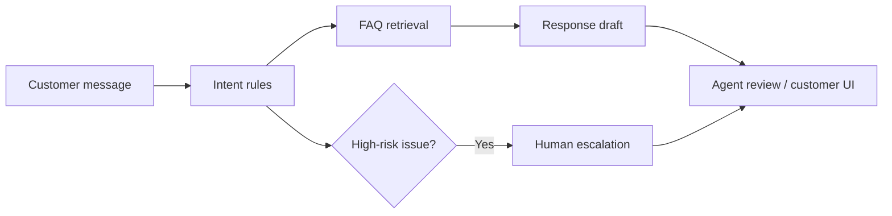

# AI Customer Support Assistant

A demo support assistant that classifies incoming messages, searches a synthetic FAQ knowledge base, drafts a helpful response, and flags messages that should be handed to a human.

**Free/local demo:** no paid LLM API or account is required. The response is assembled from curated FAQ content using deterministic retrieval and rules; it is not represented as a generative AI model.

## Features
- Lightweight intent classification for billing, account access, outage, security, and general questions.
- FAQ retrieval with visible source citations.
- Suggested response drafts, not automatically sent messages.
- Human escalation for security issues, account compromise, and unresolved outages.
- Simple responsive chat UI, FastAPI API, sample FAQ data, tests, Docker.
- Clear guardrails: never ask for passwords, OTPs, or full card details.

## Quick start
Requires Python 3.11+.

```bash
python -m venv .venv
source .venv/bin/activate  # Windows: .venv\Scripts\Activate.ps1
pip install -r requirements.txt
uvicorn app.main:app --reload
```

Open [http://127.0.0.1:8000](http://127.0.0.1:8000) or [http://127.0.0.1:8000/docs](http://127.0.0.1:8000/docs).

## API example
```bash
curl -X POST http://127.0.0.1:8000/message \
  -H "Content-Type: application/json" \
  -d '{"message":"I think someone accessed my account"}'
```

Response fields include `category`, `reply`, `sources`, `escalation_required`, and `next_action`.

## Architecture


## Project structure
```text
app/main.py
app/static/index.html
data/faq.json
tests/test_app.py
requirements.txt
Dockerfile
```

## Tests and Docker
```bash
pytest -q
docker build -t ai-customer-support-assistant .
docker run --rm -p 8000:8000 ai-customer-support-assistant
```

## Privacy and production notes
The sample FAQ is fictional and the app stores no persistent conversation history. Do not submit real personal, financial, or account-security data to a public demo. Before production, add authentication, PII handling, tenant isolation, observability, human-agent integrations, rate limits, and secure storage. Replies are drafts and must be reviewed before sending.

## Implemented vs. next steps
**Implemented:** rule-based classification, FAQ retrieval, source labels, response drafts, escalation flags, browser UI, API, tests.

**Next steps:** optional local LLM through Ollama, real ticketing integration, multilingual evaluation, feedback collection, and persistent conversation management.

## License
MIT — see [LICENSE](LICENSE).
